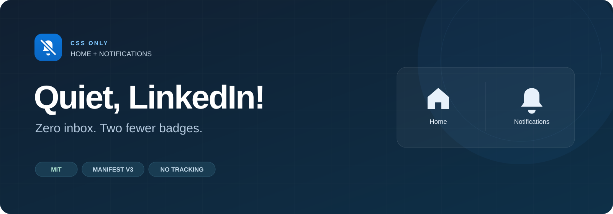
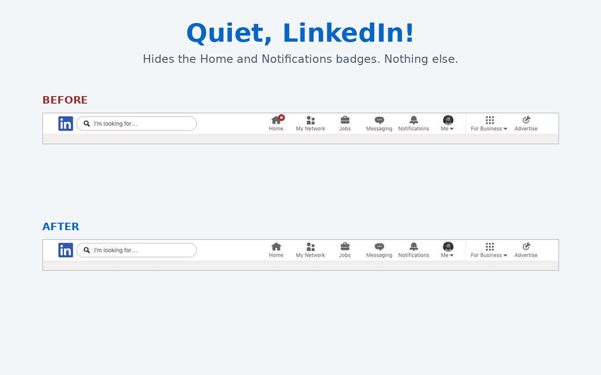

<div align="center">


# Quiet, LinkedIn!

**A calmer desktop navigation bar for intentional, zero-inbox workflows.**

[](https://github.com/paulfxyz/quiet-linkedin/releases)
[](manifest.json)
[](LICENSE)
[](https://github.com/paulfxyz/quiet-linkedin/actions/workflows/ci.yml)

[](src/quiet.css)
[](#under-the-hood)
[](#privacy-and-site-access)
[](#privacy-and-site-access)
[](PRIVACY.md)
[](manifest.json)
[](#compatibility-and-testing)



<p>
  <a href="#why-i-built-this">Why I built this</a> &middot;
  <a href="#at-a-glance-scope">Scope</a> &middot;
  <a href="#actual-screenshot">Screenshot</a> &middot;
  <a href="#installation">Install</a> &middot;
  <a href="#under-the-hood">Architecture</a> &middot;
  <a href="#privacy-and-site-access">Privacy</a> &middot;
  <a href="#compatibility-and-testing">Verification</a> &middot;
  <a href="#troubleshooting-and-faq">FAQ</a> &middot;
  <a href="#development">Development</a>
</p>

</div>

## Why I built this

I prefer zero-inbox workflows, and I dislike feeling like every red dot is another task that demands immediate attention. When I open LinkedIn to check a message or look up a profile, counter badges on Home and Notifications pull focus toward unread counts I did not ask to review.

I built Quiet, LinkedIn! so I can open the feed or check notifications on my own terms. The extension hides those two visual counters with straightforward CSS rules, leaving unread items, messaging alerts, and account states alone.

## At-a-glance scope

This extension only adjusts the visibility of badges in the top navigation bar. It does not manipulate network requests, mutate storage, or inject background scripts.

| Surface | Behavior | Details |
|---|---|---|
| **Home navigation badge** | Hidden | Scoped CSS removes numerical counts and red dots on Home icon wrappers. |
| **Notifications navigation badge** | Hidden | Scoped CSS removes numerical counts and red dots on Bell icon wrappers. |
| **Messaging & My Network badges** | Kept intact | Direct communication and connection invites remain fully visible. |
| **Jobs navigation item** | Kept intact | Untouched by layout selectors. |
| **Feed stream & content badges** | Kept intact | Badges inside individual feed cards or article updates remain untouched. |
| **Actionable buttons & navigation links** | Kept clickable | Link anchors, click handlers, text labels, and SVGs remain completely usable. |
| **Browser tabs, push, and OS alerts** | Kept intact | Tab title prefixes, tab favicons, push pings, and email alerts are unaffected. |
| **Account state & unread items** | Kept unchanged | The extension never marks anything read; LinkedIn's normal behavior is unchanged. |

## Actual screenshot

<div align="center">



<p><sub>Cropped desktop comparison showing v1.0 CSS injection on a real Comet page, not an installed extension validation run, and not proof of v1.1 two-badge production results. In this capture, Home had an active unread indicator while Notifications had zero active badges.</sub></p>

</div>

## Installation

No build step or command-line setup is required to run the extension. You install the packaged files directly into your browser using unpacked extension mode.

1. Download the [v1.1.0 source ZIP](https://github.com/paulfxyz/quiet-linkedin/archive/refs/tags/v1.1.0.zip).
2. Extract the archive into a permanent folder on your computer so the browser can read it continuously.
3. Open `chrome://extensions` in Chrome, or navigate to the extension manager in Comet.
4. Turn on the **Developer mode** toggle in the top-right corner.
5. Click **Load unpacked** and select the directory containing `manifest.json`.
6. Reload your active LinkedIn tabs to apply the stylesheet.

The source ZIP includes documentation and development files, but no build or dependency installation is needed to use it. Alternatively, developers can clone the repository using `git clone https://github.com/paulfxyz/quiet-linkedin.git` and select the repository root when clicking **Load unpacked**.

This project is distributed directly via GitHub and is not listed in the Chrome Web Store. Releases require no data or settings migration. To update, extract and replace files while retaining your chosen active directory, click the refresh icon on the extension card in your extension manager, and reload your LinkedIn tabs. The release ZIP is not automatically installed by the browser. To disable or uninstall, toggle off or click **Remove** in your extension manager, then reload LinkedIn; badges reappear immediately.

## Under the hood

The extension uses a declarative Manifest V3 structure containing a single content script entry. The stylesheet applies at document start to minimize visual flash as elements render.

```text
Browser Tab (https://www.linkedin.com/*)
  │
  └── manifest.json (content_scripts: run_at "document_start")
        │
        └── src/quiet.css
              │
              ├── Known Home / bell SVG IDs (exact small and medium variants)
              └── Explicit root link selector (/feed, /notifications)
```

Because the rules run purely in CSS, the browser evaluates them as the single-page application changes routes or swaps DOM fragments. No mutation observers, DOM polling, or JavaScript runtimes are executed inside the page.

Hashed classes are avoided, and selectors hook into navigation structures and known icon IDs (`#home-medium`, `#home-small`, `#home-fill-medium`, `#home-fill-small`, `#bell-medium`, `#bell-small`, `#bell-fill-medium`, `#bell-fill-small`). These icon IDs are not a guaranteed stable public API, and future markup updates by LinkedIn can break matching rules. Narrow selectors reduce the risk of hiding unintended elements if navigation changes occur.

```text
quiet-linkedin/                # Repository root (documentation & source)
├── manifest.json              # Extension runtime metadata
├── src/
│   └── quiet.css              # Extension runtime stylesheet
├── icons/                     # Extension runtime icons (16px to 128px)
├── INSTALL.md                 # Compact installation guide for release ZIP
├── LICENSE                    # MIT license included in release ZIP
├── PRIVACY.md                 # Site access notice included in release ZIP
├── docs/                      # Repository documentation and verification
├── screenshots/               # Visual assets for GitHub repository
├── tests/                     # Playwright test suite
├── scripts/                   # Distribution packaging helper
└── package.json               # Developer configuration
```

Runtime files loaded by the browser are `manifest.json`, `src/quiet.css`, and the `icons/` folder. The public source archive includes the rest of the repository. The optional `npm run package` command creates a smaller ZIP containing only runtime files, `INSTALL.md`, `LICENSE`, and `PRIVACY.md`, omitting screenshots and test suites.

## Privacy and site access

Quiet, LinkedIn! collects no analytics, contains no background scripts, and issues no outgoing network connections. The extension requests zero Chrome API permissions and declares no explicit host permission entries.

The declarative `content_scripts.matches` entry in `manifest.json` specifies `https://www.linkedin.com/*` so the browser can inject `src/quiet.css` into LinkedIn tabs. Your browser may therefore display a site-access disclosure; zero extra API permissions does not mean zero site access. The runtime consists of the manifest, icons, and one static CSS file, with no remote resources. Read [PRIVACY.md](PRIVACY.md) for complete details.

Status badges shown in this README are hosted externally by Shields.io and load whenever a renderer fetches the Markdown preview. These are external documentation requests made by your viewer, completely separate from the extension runtime, which makes zero network requests.

## Compatibility and testing

Quiet, LinkedIn! targets desktop Chromium browsers including Google Chrome and Comet. The extension does not modify the LinkedIn mobile application or alternative mobile browsers.

| Environment | Validation status | Notes |
|---|---|---|
| **Automated regression suite** | Passed (October 24, 2026) | 9 top-level tests passed using Chromium with intercepted fixtures. |
| **Installed unpacked Chromium** | Automated pass | Matched and nonmatched tested fixture origins confirmed isolation. |
| **Live Comet CSS injection (v1.0)** | Home verified; both pending | Visual check via injected CSS verified Home badge removal on October 24, 2026; Notifications had zero unread items; not an unpacked extension install. Chrome live not tested. |
| **Remote GitHub CI** | See dynamic badge | Check the dynamic workflow badge above or view the Actions tab for live remote status. Initial local suite passed all 9 tests. |

Detailed test methodology and verification summaries are documented in [docs/VALIDATION.md](docs/VALIDATION.md).

## Development

Running development tests requires Node.js 20 or newer. You do not need Node.js or any build tools to install and use the extension.

```sh
# Install dev dependencies
npm ci

# Install Playwright browser binaries
npx playwright install chromium

# Run the regression suite
npm test

# Create a clean distribution archive
npm run package
```

If you have a local Chromium binary available, set `CHROMIUM_PATH` before running tests to bypass local browser downloads. The packaging script requires the system `zip` utility and outputs an allowlisted archive directly to `dist/`.

Generating visual assets using `npm run assets` requires Python 3 with the Pillow library installed alongside source crop files.

## Troubleshooting and FAQ

### The badges are still visible after installing. How do I fix this?

Check `chrome://extensions` to ensure the extension is enabled and loaded from the directory containing `manifest.json`. In the extension details, allow site access to `https://www.linkedin.com/*`; no other website needs access. Reload LinkedIn after changing settings. Managed-browser policies may prevent Developer mode or unpacked extensions, and this project does not override those policies.

### Does this mark my notifications as read?

No, the extension never marks anything read or clears a notification. LinkedIn's normal account behavior is unchanged.

### Why does my browser tab still show an unread count?

Quiet, LinkedIn! alters only in-page CSS within the document. It does not alter browser tab titles, tab favicons, push notifications, or system desktop alerts.

### Does this work in the LinkedIn mobile app?

No. Quiet, LinkedIn! is designed and tested for desktop Chromium browsers. The mobile app and mobile browsers are unsupported.

### What if a LinkedIn layout update breaks badge hiding?

If LinkedIn alters its icon IDs or navigation hierarchy, badges may reappear. You can report regressions by opening an issue on GitHub with cropped screenshots that omit private profile information.

## Roadmap

Quiet, LinkedIn! remains intentionally minimal. Future maintenance will focus strictly on preserving accurate selector matching when LinkedIn updates desktop navigation.

Narrowly scoped rules to hide additional navigation items may be evaluated in future releases, but no options are currently shipped. Keeping the codebase strictly CSS provides lightweight execution.

## Contributing and license

Contributions that improve selector precision or expand test coverage are welcome. Please read [CONTRIBUTING.md](CONTRIBUTING.md) for fixture guidelines and pull request requirements.

Quiet, LinkedIn! is written by [Paul Fleury](https://github.com/paulfxyz) and licensed under the [MIT License](LICENSE). You can explore related small-tool repositories on [Paul Fleury's GitHub](https://github.com/paulfxyz).

This project is independent open-source software and is not affiliated with, sponsored by, or endorsed by LinkedIn Corporation, Google, the Chromium project, or Perplexity AI.
